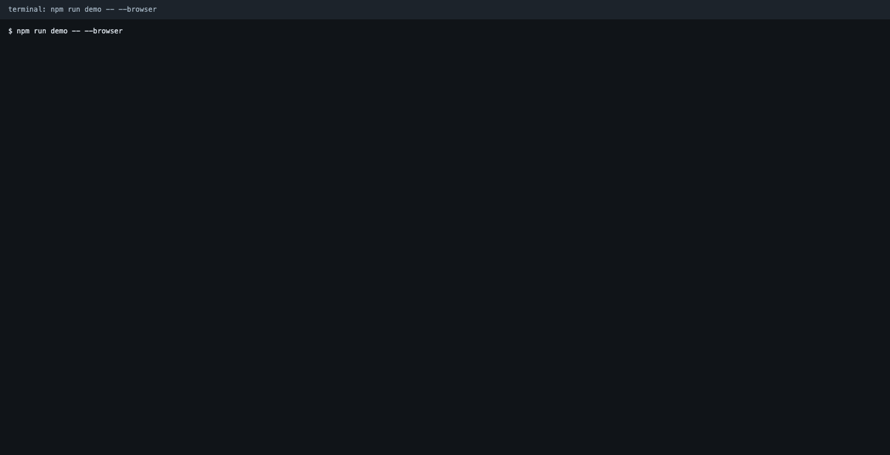
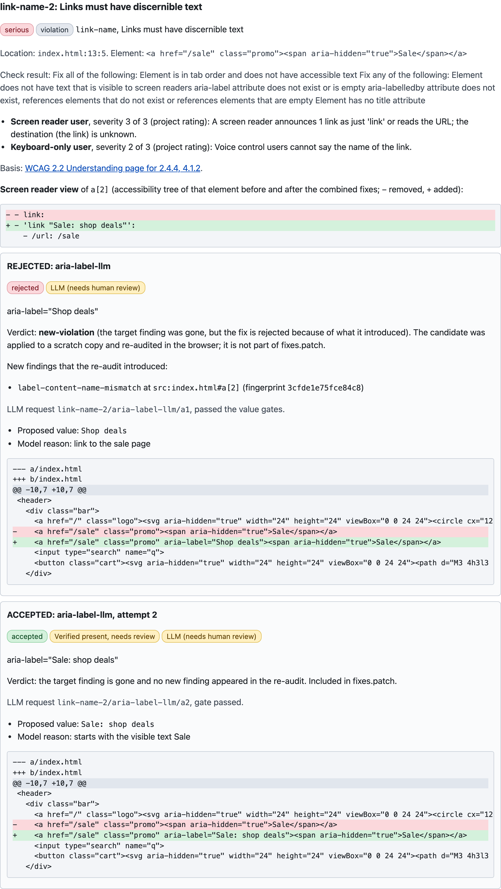
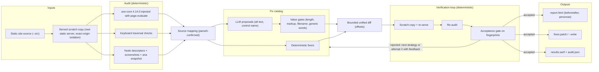

# a11y-fixgate

An LLM-assisted accessibility fixer with a deterministic verification loop.

[](https://github.com/flaviorg/a11y-fixgate/actions/workflows/ci.yml)
[](LICENSE)
[](.nvmrc)
[](package.json)
[](#12-tests-and-quality)



*Rendered from the captured output of a real run, sped up; real duration 3.3 s.*

## 1. The number and the claim

**95.9% of the top one million home pages have detected WCAG 2 failures** (WebAIM Million 2026, 56.1 errors per page, [fetched 2026-10-14](https://webaim.org/projects/million/)).
Most tools report. Some agents propose fixes ([Evinced Autopilot](https://evinced.com/) drives a coding agent; Axe MCP Server and GitHub Copilot accessibility agents suggest fixes in PRs).
One overlay vendor paid $1 million to the FTC for claiming its widget made sites conform ([accessiBe, January 2025](#10-why-not-an-overlay)).
This open-source tool edits your source, re-audits every fix in a real browser with a pure, tested acceptance gate, shows you the screen-reader view before and after, and shows you the fixes it rejected.

LLM proposal quality is not measured yet; the LLM values shown here are scripted answers from the fake provider ([docs/eval.md](docs/eval.md)).



*Scripted answer from the fake provider; LLM quality is not measured yet (docs/eval.md). Captured from the HTML report of a real Chromium run. The first proposal, "Shop deals", passed every value gate and was rejected by the browser re-audit: the link's visible text is "Sale", and the new name no longer contains it (WCAG 2.5.3). The second proposal keeps the visible text and is accepted, marked "needs human review".*

**Verified** means: re-audited in a real browser; the target failure is gone and no new axe or keyboard finding (violation or needs-review) appeared. It does not see layout, script errors or meaning; LLM-written text is marked for human review.

## 2. Run it

```bash
npm ci && npm run demo
```

No Docker, no key, no `.env`, no network after `npm ci`, and no browser for the default demo. It needs Node 24.21 or newer.

Real Chromium run (`npm run demo -- --browser`, with `A11Y_BROWSER_PATH` pointing at a Chromium, or after `npm run browser:install`), pasted from the real output:

```
$ npm run demo -- --browser

a11y-fixgate demo | audit: Chromium (A11Y_BROWSER_PATH) | LLM: fake, strict (fixtures/llm/storefront.json) | lang: en
Page: fixtures/storefront/index.html served at http://127.0.0.1:51487/  axe-core 4.14.0  tags: wcag2a wcag2aa wcag21a wcag21aa wcag22a wcag22aa

Baseline: 15 axe violations (8 rules), 1 needs-review, 3 keyboard findings
  document-title 1 | html-has-lang 1 | link-name 2 | label 3 | button-name 1 | image-alt 4 | color-contrast 1 | target-size 2
  needs-review: color-contrast h1
  keyboard: focus-obscured a.skip | unreachable-control div.btn | keyboard-trap #qty
Mapping: 18 mapped (ordinal 12, signature 6), 1 unmapped

Fix loop (each candidate verified in a scratch copy, re-audited, judged on fingerprints; caps: 60 candidates, 40 LLM calls, 600 s)
 [1] document-title      title-from-h1              deterministic  accepted   <title>Orbit Outfitters</title>  verified
 [2] html-has-lang       html-lang                  deterministic  accepted   lang="en"  verified
 [3] focus-obscured      focus-obscured-advice      suggest-only   suggest    Focused body > a.skip is fully (5 of 5 points) covered by body > header > div.banner > h1; add... (catalog)
 [4] link-name           aria-label-llm             llm            accepted   aria-label="Orbit Outfitters home"  verified present, needs review
 [5] link-name           aria-label-llm             llm            REJECTED   aria-label="Shop deals" passed every value gate; re-audit: new-violation: label-content-name-mismatch
     link-name           aria-label-llm             llm            accepted   aria-label="Sale: shop deals" (attempt 2)  verified present, needs review
 [6] label               aria-label-llm             llm            accepted   aria-label="Search products"  verified present, needs review
 [7] button-name         aria-label-llm             llm            accepted   aria-label="Open cart"  verified present, needs review
 [8] image-alt           alt-text-llm               llm            accepted   alt="Orbit Outfitters autumn collection banner"  verified present, needs review
 [9] image-alt           alt-text-llm               llm            gate-rejected (alt-is-filename)
     image-alt           alt-text-llm               llm            accepted   alt="Green waterproof trail jacket with hood" (attempt 2)  verified present, needs review
[10] unreachable-control unreachable-control-advice suggest-only   suggest    Use <button> instead of <div onclick>; or add tabindex="0", role="button" and a keydown handler for Enter... (catalog)
[11] image-alt           alt-text-llm               llm            accepted   alt="Green trail jacket, kids size"  verified present, needs review
[12] color-contrast      contrast-inline            deterministic  accepted   color:#9a9a9a -> #767676 (2.81:1 -> 4.54:1 on #ffffff)  verified present, design review
[13] image-alt           alt-text-llm               llm            suggest    decorative proposed (alt=""): visual separator (decorative-needs-decision)
[14] label               label-associate            deterministic  REJECTED   id="email" / for="email"; re-audit: new-incomplete: duplicate-id-aria
     label               label-fresh-id             deterministic  accepted   id="email-2" / for="email-2"  verified
[15] target-size         target-size-advice         suggest-only   suggest    Target .step-down is 16 by 16 px; the minimum is 24 by 24 px (catalog)
[16] target-size         target-size-advice         suggest-only   suggest    Target .step-up is 16 by 16 px; the minimum is 24 by 24 px (catalog)
[17] keyboard-trap       keyboard-trap-advice       suggest-only   suggest    Focus stayed on #qty for 3 Tabs; keydown handlers that cancel Tab must let it through or provide an exit (Esc) (catalog)
[18] label               unmapped                   no patch       no-candidate

Combined audit (11 accepted fixes merged, 0 conflicts): 4 axe violations remaining (image-alt 1, target-size 2, label 1), 1 needs-review, 3 keyboard findings, 0 new
Accepted 11 (verified 3, needs human review 8: 7 LLM + 1 design review) | rejected 2 | gate-rejected 1 (retried) | suggest-only 6 | unmapped 1
Screen reader view, a.promo:  - link  ->  + link "Sale: shop deals"
Remaining in source: 8 critical (label, button-name, image-alt), 8 serious (document-title, html-has-lang, link-name, unreachable-control, color-contrast, target-size). Fixable by fixes.patch: 11.

Outputs: reports/demo/report.html  fixes.patch (1 file)  results.sarif (18 results)  audit.json  screenshots/page.png, page.after.png
Finished in 3.3 s (Chromium, 15 audits). npm run demo without flags replays these recordings in under 10 s.
```

*Real Chromium run, 2026-10-14.* `npm run demo` without flags replays the recordings of that same run and prints the same summary without a browser, in well under 10 seconds (`docs/demo-output.md` has both outputs).
The HTML report of that run is committed: open [docs/sample-report/report.html](docs/sample-report/report.html) from a clone; it needs no server.

**On your own site** (clone and run; there is deliberately no `npx` one-liner in v1, see the limitations):

```bash
git clone https://github.com/flaviorg/a11y-fixgate.git && cd a11y-fixgate
npm ci && npm run browser:install          # once; installs the Chromium build the pinned playwright-core expects
npm run audit -- --src /abs/path/to/site/public --repo-root /abs/path/to/site --lang en --out /abs/path/to/site/a11y-report
```

`--src` and `--repo-root` are absolute because `npm run` executes in the clone. The default LLM provider is the lenient fake: on a page its scripted answers do not cover, the LLM
strategies become suggestions, and the run exits 0 with a report, a patch of the deterministic fixes and SARIF. Set `LLM_PROVIDER=none` to turn the LLM strategies off.

## 3. How a fix is verified



1. Each candidate is applied to a **scratch copy** of your source (symlinks never copied), served on an ephemeral loopback port, and audited again in a real browser.
2. Findings are compared by **fingerprint**: rule plus source anchor, never a CSS selector, which drifts when a fix adds an attribute.
3. A pure **acceptance gate** accepts a candidate only if the target is gone and no new axe or keyboard finding showed up, not even a needs-review item. A violation that merely moves to needs-review is rejected.
4. The accepted edits are merged per file, applied once and audited once more; that audit is the "after" state of the report.

The two rejections of the demo, in this order:

1. **The model's plausible name, rejected by the browser.** `aria-label="Shop deals"` on the promo link passed every value gate. Only the re-audit saw the new
   violation, `label-content-name-mismatch`: the name hid the visible text "Sale". The verdict went back to the model and attempt 2, "Sale: shop deals", was accepted.
2. **What a static fixer would have done.** The first `label` strategy reasons over source files only, which is all a static fixer or codemod can know, and gave the email field
   `id="email"`. A script on the page injects the same id, so the re-audit found `duplicate-id-aria`. The second strategy consults the live DOM and chose `email-2`. Why the first
   strategy exists is in [ADR 0006](docs/adr/0006-source-only-first-label-strategy.md).

Together they show that the loop is a gate, not a formality, for the model and for code alike.

## 4. What is deterministic, what is LLM, what is fake

| Deterministic code (decides, verifies, measures) | LLM (proposes, classifies the ambiguous) | Fake in tests and demo |
|---|---|---|
| axe-core execution, the set of rules, the tag set | alt text for an image (vision in real mode) | The LLM: a scripted provider keyed by a hash of task plus input |
| keyboard traversal (three checks): unreachable controls (violation); traps and obscured focus (heuristics, reported as `incomplete`, never fixed) | the accessible name of an icon-only button or link, or of an unlabeled text input | Nothing else. The browser, axe, parse5, the diff library and the gates are real in e2e tests; unit tests use recorded axe results or scripted snapshots |
| DOM node to source file and offset mapping (parse5-confirmed, never guessed); the inventory of ids in the live DOM | whether an image is decorative (a `decorative` answer is never applied: it becomes a suggestion for a human) | |
| every mechanical fix (`lang`, `title`, label association, contrast color), the bounded unified diff, the acceptance gate, the fingerprints, SARIF, exit codes, the `--fail-on` decision | | |
| the impact per persona (a catalog of templates per rule, each citing the WCAG Understanding page of its criterion, with a 0 to 3 project rating); the screen reader view before and after | | |

The LLM never emits a diff: it proposes a value, code builds the diff, and code decides. Two statuses appear in every output: `verified` (deterministic, no human review needed) and
`verified-present, needs review` (an LLM-written value, a contrast color or an inferred `lang`). `--write` writes only `verified` fixes; everything else stays in `fixes.patch` and the report.

## 5. What it checks

- **axe-core 4.14.0** with the tags `wcag2a`, `wcag2aa`, `wcag21a`, `wcag21aa`, `wcag22a`, `wcag22aa`: 66 rules, no `best-practice` rule. It includes `target-size` (2.5.8), the one WCAG 2.2 AA criterion axe automates.
- **Three keyboard checks**: `unreachable-control` (2.1.1, a violation), `keyboard-trap` (2.1.2, a heuristic reported as needs-review) and `focus-obscured` (2.4.11, a heuristic reported as needs-review). They report and never fix.
- **LLM-judged content checks**: alt text and accessible names, proposals that the gates and the browser then check for presence.

[docs/coverage.md](docs/coverage.md) lists the 2.2 AA criteria that are not checked (2.5.7, 3.2.6, 3.3.7, 3.3.8) and says that iframe content is not audited.

## 6. Outputs

- **`report.html`**: a single file with a strict Content-Security-Policy and no script. Every untrusted string is escaped, and the report passes this tool's own audit (0 violations, 0 keyboard findings; `tests/e2e/report-self-audit.e2e.test.ts`). Sample: [docs/sample-report/report.html](docs/sample-report/report.html).
- **`fixes.patch`**: one diff per touched file, names relative to the repository root. Apply it with `cd <repo> && git apply a11y-report/fixes.patch`.
- **`--write`**: writes only `verified` fixes (deterministic and not flagged for human review). Needs-review fixes stay in `fixes.patch`.
- **`results.sarif`**: SARIF 2.1.0 for code scanning. Results are the findings that are still in your files; an accepted fix that exists only in `fixes.patch` is still an open alert until the patch lands.
- **`audit.json`**: the whole result, with no absolute path and no secret.

`--fail-on <impact>` decides on what is in the files, not on what a patch could do. The plain CI workflow below is "SARIF plus a reviewable patch artifact" and never commits to your repository:

```yaml
# .github/workflows/a11y.yml in a consumer repo
permissions:
  contents: read
  security-events: write
jobs:
  a11y:
    runs-on: ubuntu-latest
    steps:
      - uses: actions/checkout@v7
      - uses: actions/checkout@v7
        with:
          repository: flaviorg/a11y-fixgate
          ref: v0.1.0
          path: .a11y-tool
      - uses: actions/setup-node@v7
        with:
          node-version-file: .a11y-tool/.nvmrc
      - run: npm ci --prefix .a11y-tool && npm run --prefix .a11y-tool browser:install
      - run: node .a11y-tool/src/cli.ts audit --src public --page / --lang en --repo-root "$GITHUB_WORKSPACE" --out a11y-report --fail-on serious
        env:
          LLM_PROVIDER: none   # LLM strategies become suggestions; set a provider and key from secrets to get proposals
      - uses: github/codeql-action/upload-sarif@v4
        if: always()
        with:
          sarif_file: a11y-report/results.sarif
      - uses: actions/upload-artifact@v7
        if: always()
        with:
          name: a11y-report
          path: a11y-report
```

Whether a code-scanning alert lands on the right line of a real repository can only be checked once the repository is published; no screenshot of one is shown here.

## 7. Architecture

Hexagonal layers with tested boundaries ([docs/architecture.md](docs/architecture.md)).

- `src/contracts` and `src/domain`: Zod contracts and pure logic (mapping, fixers, gates, fingerprints, acceptance gate, combine). No `node:*`, no browser, no LLM.
- `src/browser`: the only code that imports Playwright; axe is injected with `page.evaluate`, with no adapter package ([ADR 0007](docs/adr/0007-axe-without-adapter.md)).
- `src/infra`: filesystem guards, the static server, scratch copies, recordings, logging and redaction.
- `src/llm`: the fake, none and OpenAI-compatible providers; only `openai-compatible.ts` calls `fetch`.
- `src/app`: the fix loop and the orchestrator. `src/output`: report, patch, SARIF, JSON and summary. `src/cli.ts` and `scripts/demo.ts` write stdout through a redacting function.
- Dependency rules are tested (`tests/repo/conventions.unit.test.ts`). Five runtime dependencies at exact versions: `playwright-core`, `axe-core`, `parse5`, `diff`, `zod`.

## 8. Security model

1. **Adversaries:** the author of the audited page (markup, scripts, image files), the LLM provider and its output, and text or an image that carries instructions.
2. **Protected:** your filesystem, `LLM_API_KEY`, local services reachable from the audit browser, and the browser that opens the report.
3. **Files:** every project file read for a model or written by `--write` goes through realpath containment, refuses symlinks and has a size cap.
4. **Model output:** a Zod shape and value gates, with page content in `<untrusted-content>` delimiters. This bounds the shape of the output, not its meaning.
5. **Browser and report:** the audit browser reaches only the tool's own origin (other ports, WebSockets and service workers are blocked); the report escapes every string and ships a CSP with no script.
6. **Secrets:** the key is redacted from everything that leaves the process, and tests have no network.

Each control is linked to the test that proves it in [docs/threat-model.md](docs/threat-model.md).

## 9. Using a real model

```bash
export LLM_PROVIDER=openai-compatible
export LLM_BASE_URL=https://openrouter.ai/api/v1     # https, or http on loopback only
export LLM_MODEL=<model name>
export LLM_API_KEY=<your key>                         # never commit it; .env is ignored
# optional: LLM_REQUEST_OVERRIDES='{"max_tokens":null,"max_completion_tokens":300,"temperature":null}' for providers that reject a field
npm run audit -- --src /abs/path/to/site/public --repo-root /abs/path/to/site --lang en --out /abs/path/to/site/a11y-report
```

No real model has been run for this README yet, so no provider or override is listed as working. With a real model the image bytes are sent as vision input; the gates, the verification and the
needs-review flag do not change. See [docs/eval.md](docs/eval.md): the evaluation has not run, and the file describes its design.

## 10. Why not an overlay

An overlay changes the page in the visitor's browser at run time; this tool edits your source files and shows every change. Hundreds of accessibility practitioners signed the [Overlay Fact Sheet](https://overlayfactsheet.com/en/).
In January 2025 the FTC announced a $1 million order against accessiBe (press release of 3 January 2025), one overlay vendor, for claiming its widget could bring any website into conformance with WCAG.

## 11. Standards and law, honestly

This tool helps find and fix common WCAG 2.2 AA failures. It is not a conformance audit and not legal advice. Sources and verification status are in [docs/standards-and-law.md](docs/standards-and-law.md).

- **WCAG 2.2** is a W3C Recommendation (first published 5 October 2023). 4.1.1 Parsing was removed. Of the new AA criteria, this tool checks 2.5.8 Target Size via axe and approximates 2.4.11 Focus Not Obscured with a heuristic; it does not check 2.5.7, 3.2.6, 3.3.7 or 3.3.8.
- **[EN 301 549 V4.1.1](https://www.etsi.org/deliver/etsi_en/301500_301599/301549/)** (published by ETSI in September 2026) aligns with WCAG 2.2 A/AA; WCAG 2.2 AA is the direction of travel for European conformance. The Official Journal citation date is not stated here: it is unverified.
- **European Accessibility Act** ([Directive (EU) 2019/882](https://eur-lex.europa.eu/eli/dir/2019/882/oj)): applies since 28 June 2025 to services such as e-commerce and banking; microenterprises providing services are exempt; the Directive does not name WCAG, and conformance is shown via EN 301 549.
- **Brazil, Lei 13.146/2015 (LBI), Art. 63**: requires accessibility of websites maintained by companies with seat or commercial representation in the country and by government bodies, following internationally adopted best practices and guidelines; it does not name WCAG or a version. In force since 2016.
- The WebAIM figure counts failures detected by automated checks; real barriers are more numerous. A 2021 study by Deque, axe's maker, of its own audits reports that automated testing found 57% of issues by volume (the older rule of thumb: 20 to 30% of success criteria).

## 12. Tests and quality

- A pyramid: pure unit tests over recorded audits and scripted snapshots, e2e tests with a real Chromium and spawned CLI runs, and repository checks (dependency rules, EARS IDs, forbidden phrases, Mermaid labels).
- **Recorded audits** are snapshots a real browser produced, keyed by a hash of the whole served tree plus the watch list ([docs/recorded-audits.md](docs/recorded-audits.md)). `npm run fixtures:record -- --check` lists missing keys without a browser.
- The **fake provider** is keyed by a hash of task plus input, strict in tests and in the demo ([docs/fake-provider.md](docs/fake-provider.md)).
- **No network:** `npm test` loads a guard that replaces `fetch` and `net.Socket.prototype.connect` and allows only loopback; tests need no key.
- **Skip versus fail:** browser tests skip locally when no Chromium is found and fail when `REQUIRE_BROWSER=1` or `CI` is set.
- `npm run test:coverage` prints line coverage for `src/**` without a gate: `src/browser` and `src/cli.ts` run mostly in e2e.
- There is no LLM quality number, because no model has been run (see [docs/eval.md](docs/eval.md)). Tests assert gates and structure, never a model's wording.

```bash
npm run typecheck
npm test                                              # browser tests skip without a Chromium
A11Y_BROWSER_PATH=/path/to/chromium REQUIRE_BROWSER=1 npm test
npm run test:live                                     # real LLM proposals; skipped without LLM_API_KEY
```

## 13. Process

Specs with EARS criteria and a checklist of tests ([specs/](specs/), starting with the [constitution](specs/constitution.md)); every test name starts with its criterion, `[VER-02]`. [AGENTS.md](AGENTS.md) holds the
working rules; `.githooks/pre-commit` runs typecheck, unit tests and the secrets scan (`npm run setup:hooks` enables it). CI uses no secret. Decisions are in [docs/adr/](docs/adr/) and the problems met while building are in
[docs/incidents/](docs/incidents/README.md).

## 14. Known limitations

- Static HTML only. Patches apply to the files `--src` points at, so for a generated site run against the authored HTML, or make the build emit `data-a11y-source` (snippet in [docs/architecture.md](docs/architecture.md)).
- One page per run. Iframe content is not audited, and nodes inside shadow roots are reported but never mapped or fixed.
- The heuristics for 2.4.11 and keyboard traps are validated on the fixture only.
- LLM fixes need human review and are not written by `--write`. LLM quality is not measured, and vision is untested offline.
- A `decorative` verdict is never applied; it becomes a suggestion.
- Contrast is fixed only for inline styles, by HSL lightness (not perceptually uniform).
- Keyboard findings are not auto-fixed. `lang` is fixed only with `--lang` or a page signal.
- There is no one-command install: Node 24 refuses to strip types from files under `node_modules`, so a clone is required.
- Validated on Node 24.21 on macOS; the CI workflow runs on `ubuntu-latest` on every push and pull request.

## 15. License

[MIT](LICENSE). axe-core is MPL-2.0, used unmodified and injected from `node_modules` at run time; see [NOTICE](NOTICE).
