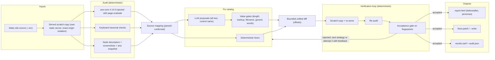
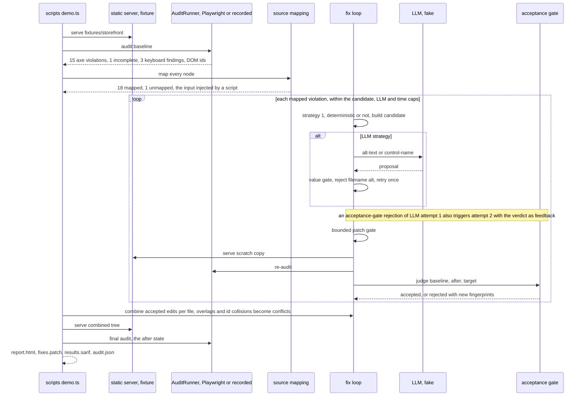

# Architecture

The tool is a loop: audit, map, propose, verify, decide. Deterministic code owns every step except the proposal of a
value, and even that value passes gates before it becomes an edit.

## The loop



Two loops are nested. The outer loop walks the findings of the baseline audit. The inner loop tries the strategies of
a rule in order until one candidate is accepted or the list is exhausted. Every audit, the baseline included, runs on
a scratch copy built with the same filter, so the baseline and the candidates are always compared on the same tree.
Every candidate is verified against the baseline in its own scratch copy. At the end the edits of all accepted
candidates are merged at the edit level, applied once to the baseline files, served and audited once more: that audit
is the "after" state of the report.

## One run, in order



## Components

| Component | File | Single responsibility |
|---|---|---|
| Contracts | `src/contracts/*.ts` | Zod schemas and types shared by every layer: findings, node descriptors, source locations, fix candidates, verdicts, snapshots, SARIF subset, config, LLM tasks |
| Fingerprint | `src/domain/verify/fingerprint.ts`, `src/domain/hash.ts` | One identity per finding, by rule plus source anchor; a pure FNV-1a 64-bit hash keeps `node:crypto` out of the domain |
| Acceptance gate | `src/domain/verify/acceptance-gate.ts` | Pure `judge(baseline, after, target)` over finding sets of fingerprints |
| Combine | `src/domain/verify/combine.ts` | Pure edit-level merge of all accepted candidates, one diff per file |
| Patch bounds | `src/domain/fix/bounded-patch.ts` | Splicing at offsets, `createTwoFilesPatch`, strict re-apply, the bounds gate |
| Id allocator | `src/domain/fix/id-allocator.ts` | One run-level source of generated ids |
| Catalog and fixers | `src/domain/fix/catalog.ts`, `fixers/*.ts` | The ordered strategies per rule; one file per strategy, pure over the parsed source |
| Value gates | `src/domain/fix/gates.ts` | Validation of LLM proposals (`alt`, control name) |
| Contrast math | `src/domain/color/contrast.ts` | sRGB luminance, ratio, nearest compliant color by lightness |
| Source mapping | `src/domain/map/source-map.ts`, `html-index.ts`, `page-file.ts` | parse5 index, DOM node to source location or an unmapped reason, page resolver |
| Personas | `src/domain/personas/*.ts` | Impact templates per rule and persona, each citing a WCAG Understanding page |
| Keyboard analysis | `src/domain/keyboard/analyze.ts` | Pure: traversal trace to the three keyboard findings |
| Ports | `src/domain/ports.ts` | `AuditRunner`, `Clock`, `Logger`, `StaticServerFactory`, `ScratchFactory` |
| Playwright runner | `src/browser/playwright-runner.ts` | The only module importing `playwright-core`: launch, exact-origin routing, axe by `page.evaluate`, descriptors, DOM ids, traversal, screenshots, aria snapshots |
| Recorded runner | `src/infra/recorded-runner.ts` | An `AuditRunner` that replays stored snapshots by `recordingKey` |
| Static server, scratch, safe reads | `src/infra/*.ts` | `node:http` server with realpath containment, scratch copies with caps, `readInsideRoot` |
| LLM providers | `src/llm/*.ts` | Fake (strict or lenient), none, OpenAI-compatible over raw `fetch`; prompts under `prompts/v1` |
| LLM strategies, page context | `src/app/llm-strategies.ts`, `page-context.ts` | Build the input from the source, call the provider, run the gates, build the plan |
| Orchestrator | `src/app/run-audit.ts`, `fix-loop.ts` | Sequences baseline, mapping, loop, combine, combined audit and `--write` |
| Outputs | `src/output/*.ts` | Escaped report, patch file, SARIF, `audit.json`, summary |
| CLI and demo | `src/cli.ts`, `scripts/demo.ts` | Arguments, environment, exit codes, signals, redacting stdout |

## Dependency rules (checked by `tests/repo/conventions.unit.test.ts`)

1. `src/contracts/**` and `src/domain/**` import no `node:*`, `playwright-core`, runtime `axe-core`, or anything from
   `src/browser|infra|llm|app|output` and `src/cli.ts`. They may import `zod`, `parse5` and `diff`.
2. Only `src/browser/**` imports `playwright-core`. Only `src/browser/axe-config.ts` imports `axe-core` at run time.
3. Only `src/llm/openai-compatible.ts` calls `fetch`.
4. Only `src/cli.ts`, `scripts/*.ts` and `tests/**` read `process.env`.
5. `src/**` has no `console.log`, `console.info` or `console.debug`. Stdout is written through the redacting `writeOut()`.
6. Erasable TypeScript only, relative imports end in `.ts`, Zod is imported as a namespace.

## Fingerprint

`fingerprint = fnv1a64("v1|" + ruleId + "|" + anchor)`. The anchor is the source anchor `src:<file>#<tag>[<ordinal>]` when
the node is mapped, or the start-tag signature (tag plus sorted attributes, descendants excluded) when it is not. The
status (`violation` or `incomplete`) only chooses the bucket and is never hashed; a CSS selector is never part of it,
because selectors drift when a fix adds an attribute (the email field is `#email` before a fix and
`input[aria-label="..."]` after). The same function is used for findings, finding sets, SARIF `partialFingerprints` and the gate's target.

## Combine rule

Candidates are always built from the baseline source text. At the end of the loop `combineEdits(baseline, accepted, domIds)`
merges the edits of every accepted candidate per file: a candidate whose range overlaps an earlier one, shares its
start tag or starts at the same offset is a `conflict` (`overlap`), and one whose generated id collides with a file id,
a DOM id or an earlier candidate's id is a `conflict` (`id-collision`). The remaining edits are applied once and one
unified diff per file is produced. Applying diffs one after another would fail for edits a few lines apart (jsdiff
cannot re-apply the second diff to the already patched file), which is why the merge is at the edit level.

## The `data-a11y-source` convention

When a build generates the HTML, `--src` on the output means a patch is lost on the next build. The tool maps a node to the
authored file when the element carries `data-a11y-source="file:line:col"` (1-based line and column of its start tag
in the file the patch edits, relative to `--src`) and an element of the same tag starts there. The two sketches below
show where a build could emit it. They are not run by this repository's tests; the tool's side of the contract is
tested in `tests/unit/source-map.unit.test.ts`.

11ty 3 (a preprocessor adds the attribute while the template text is still the authored text):

```js
eleventyConfig.addPreprocessor("a11y-source", "html", (data, content) =>
  content.replace(/<(img|a|button|input)\b/g, (tag, name, at) => {
    const line = content.slice(0, at).split("\n").length, col = at - content.lastIndexOf("\n", at - 1);
    return `${tag} data-a11y-source="${data.page.inputPath}:${line}:${col}"`;
  }));
```

Astro (the dev server annotates elements with their source file and position; map them to the convention in a
post-build step, and check the attribute names in your Astro version):

```js
// postbuild.mjs: <div data-astro-source-file="/abs/src/pages/index.astro" data-astro-source-loc="12:5">
html = html.replace(/data-astro-source-file="([^"]+)" data-astro-source-loc="(\d+):(\d+)"/g,
  (_, file, line, col) => `data-a11y-source="${path.relative(srcRoot, file)}:${line}:${col}"`);
```

In both cases the path must be relative to the directory passed as `--src`, and the file must be the one the patch should edit.
